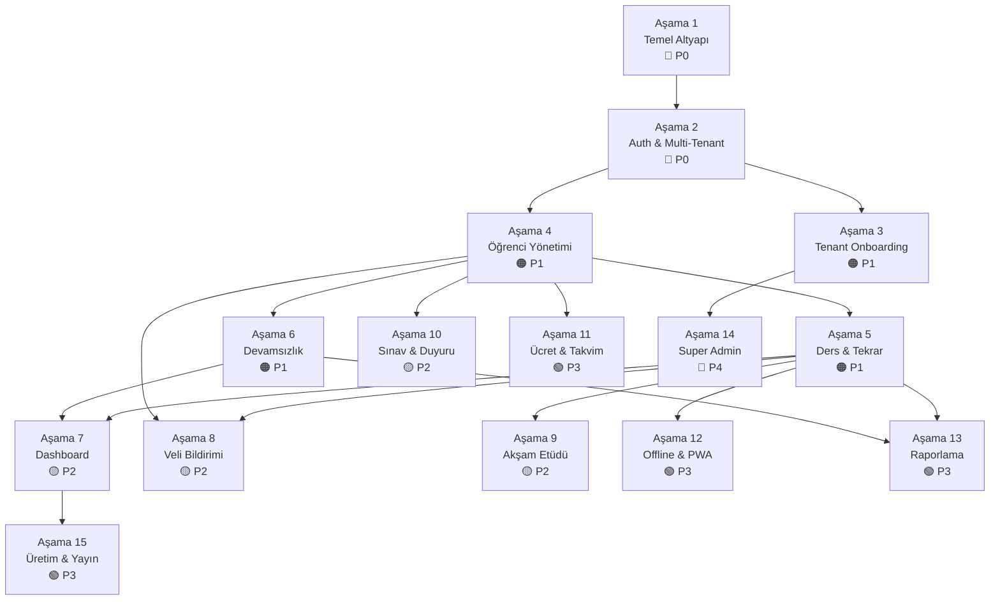

# 🗺️ Hafız Takip — Geliştirme Roadmap'i

> **İşlem Öncelikleri · Kritik Noktalar · Katman Bazlı Görevler**
> Her aşama için hangi katmanda ne yapılacağı, öncelik sırası ve dikkat edilecek noktalar belirtilmiştir.

---

## 📋 İçindekiler

1. [Öncelik Matrisi](#1-öncelik-matrisi)
2. [Bağımlılık Grafiği](#2-bağımlılık-grafiği)
3. [Aşama 1 — Temel Altyapı](#aşama-1--temel-altyapı)
4. [Aşama 2 — Kimlik Doğrulama & Multi-Tenant](#aşama-2--kimlik-doğrulama--multi-tenant)
5. [Aşama 3 — Tenant Onboarding & Kurs Yönetimi](#aşama-3--tenant-onboarding--kurs-yönetimi)
6. [Aşama 4 — Öğrenci Yönetimi](#aşama-4--öğrenci-yönetimi)
7. [Aşama 5 — Ders & Tekrar Kaydı](#aşama-5--ders--tekrar-kaydı)
8. [Aşama 6 — Devamsızlık Takibi](#aşama-6--devamsızlık-takibi)
9. [Aşama 7 — Dashboard](#aşama-7--dashboard)
10. [Aşama 8 — Veli Bildirimi & Portalı](#aşama-8--veli-bildirimi--portalı)
11. [Aşama 9 — Akşam Etüdü](#aşama-9--akşam-etüdü)
12. [Aşama 10 — Sınav & Duyuru](#aşama-10--sınav--duyuru)
13. [Aşama 11 — Ücret & Takvim](#aşama-11--ücret--takvim)
14. [Aşama 12 — Offline & PWA](#aşama-12--offline--pwa)
15. [Aşama 13 — Raporlama & Analitik](#aşama-13--raporlama--analitik)
16. [Aşama 14 — Platform Yönetimi & Super Admin](#aşama-14--platform-yönetimi--super-admin)
17. [Aşama 15 — Üretim & Yayın](#aşama-15--üretim--yayın)
18. [Risk Haritası & Azaltma Stratejileri](#risk-haritası--azaltma-stratejileri)
19. [Önemli Noktalar Özet Tablosu](#önemli-noktalar-özet-tablosu)

---

## 1. Öncelik Matrisi

Her aşama aşağıdaki öncelik seviyelerine göre sınıflandırılmıştır:

| Seviye | Etiket | Anlam |
|--------|--------|-------|
| 🔴 P0 | **Kritik** | Bu olmadan proje çalışmaz. İlk yapılmalı. |
| 🟠 P1 | **Yüksek** | MVP için zorunlu. İlk 3 ayda tamamlanmalı. |
| 🟡 P2 | **Orta** | Beta kullanıcılara açılmadan önce olmalı. |
| 🟢 P3 | **Düşük** | Canlıya alım sonrası eklenebilir. |
| 🔵 P4 | **İleri Aşama** | Ölçeklenme ve büyüme fazında. |

### Aşama — Öncelik Eşleştirmesi

| Aşama | Başlık | Öncelik | Tahmini Süre | Bağımlılık |
|:------:|--------|:-------:|:------------:|:----------:|
| 1 | Temel Altyapı | 🔴 P0 | 2 hafta | — |
| 2 | Kimlik Doğrulama & Multi-Tenant | 🔴 P0 | 2 hafta | Aşama 1 |
| 3 | Tenant Onboarding & Kurs Yönetimi | 🟠 P1 | 2 hafta | Aşama 2 |
| 4 | Öğrenci Yönetimi | 🟠 P1 | 2 hafta | Aşama 2 |
| 5 | Ders & Tekrar Kaydı | 🟠 P1 | 3 hafta | Aşama 4 |
| 6 | Devamsızlık Takibi | 🟠 P1 | 1 hafta | Aşama 4 |
| 7 | Dashboard | 🟡 P2 | 1 hafta | Aşama 4,5,6 |
| 8 | Veli Bildirimi & Portalı | 🟡 P2 | 2 hafta | Aşama 4,5 |
| 9 | Akşam Etüdü | 🟡 P2 | 1 hafta | Aşama 5 |
| 10 | Sınav & Duyuru | 🟡 P2 | 2 hafta | Aşama 4 |
| 11 | Ücret & Takvim | 🟢 P3 | 2 hafta | Aşama 4 |
| 12 | Offline & PWA | 🟢 P3 | 2 hafta | Aşama 5 |
| 13 | Raporlama & Analitik | 🟢 P3 | 2 hafta | Aşama 5,6 |
| 14 | Platform Yönetimi & Super Admin | 🔵 P4 | 3 hafta | Aşama 3 |
| 15 | Üretim & Yayın | 🟢 P3 | 2 hafta | Aşama 1-7 |

---

## 2. Bağımlılık Grafiği



### Paralel Geliştirme Fırsatları

Bazı aşamalar birbirinden bağımsız olduğu için paralel geliştirilebilir:

| Paralel Grup | Aşamalar | Açıklama |
|-------------|----------|----------|
| **Grup A** | Aşama 3 + Aşama 4 | Tenant onboarding ile öğrenci yönetimi aynı anda |
| **Grup B** | Aşama 5 + Aşama 6 | Ders kaydı ile devamsızlık paralel geliştirilebilir |
| **Grup C** | Aşama 8 + Aşama 9 + Aşama 10 | Veli, etüt ve sınav modülleri bağımsız |
| **Grup D** | Aşama 11 + Aşama 12 + Aşama 13 | Ücret, offline, raporlama bağımsız |

---

## Aşama 1 — Temel Altyapı

> **Öncelik: 🔴 P0 · Süre: 2 hafta · Bağımlılık: —**

### 🎯 Hedef
Projeyi tüm katmanlarda ayağa kaldır, multi-tenant çerçevesini ve tasarım sistemini kur.

### ⚠️ Kritik Noktalar
- Backend solution yapısı ilk günden doğru kurulmalı — sonradan N-Tier'a geçiş çok maliyetli
- Veritabanı tablolarındaki `tenant_id` alanları baştan konulmalı, sonradan eklenmesi her FK'yı etkiler
- CSS değişkenleri ve tasarım tokenleri tek seferde doğru tanımlanmalı, tüm bileşenler buradan beslenecek
- Flutter ve Web projeleri aynı renk/font/spacing tokenlerini kullanmalı — farklılaşma başlarsa sonra tutarlılık sağlanamaz

### 📋 Katman Bazlı Görevler

#### 🗄️ Veritabanı (Öncelik: 1/4)
| # | Görev | Öncelik | Not |
|---|-------|:-------:|-----|
| 1 | Platform tablolarını oluştur (`tenants`, `subscriptions`, `invoices`) | 🔴 | tenant_id FK yok |
| 2 | Tenant tablolarını oluştur (tümü `tenant_id` zorunlu) | 🔴 | İlk migration |
| 3 | RLS politikalarını yaz (Supabase ise) | 🔴 | Her tablo için ayrı policy |
| 4 | Index stratejisini uygula | 🟠 | `IX_*_tenant_id` her tabloda |
| 5 | Seed data hazırla (114 sure, cüz-sayfa eşleştirmesi) | 🟠 | Sabit referans veriler |

> [!IMPORTANT]
> Veritabanı ilk yapılacak katmandır. Backend entity'leri buradan şekillenecek.

#### 🔧 Backend (Öncelik: 2/4)
| # | Görev | Öncelik | Not |
|---|-------|:-------:|-----|
| 1 | `HafizTakip.sln` oluştur (5 proje) | 🔴 | API, Business, DataAccess, Entities, Core |
| 2 | Entity katmanını yaz (tüm model sınıfları) | 🔴 | `ITenantEntity` interface dahil |
| 3 | `HafizTakipDbContext` + Global Query Filter | 🔴 | Multi-tenant filtre |
| 4 | İlk EF Core migration | 🔴 | Code-First |
| 5 | `IResult` / `IDataResult<T>` yapısı | 🔴 | Core katmanında |
| 6 | Generic Repository pattern | 🟠 | DataAccess katmanında |
| 7 | `ExceptionHandlingMiddleware` | 🟠 | Global hata yakalama |
| 8 | CORS ayarları | 🟠 | Web ve mobil origin'leri |
| 9 | Swagger yapılandırması | 🟡 | Geliştirme kolaylığı |
| 10 | `appsettings.json` yapısı | 🟠 | ConnectionString, JWT ayarları |

> [!WARNING]
> Katman bağımlılık kuralı: API → Business → DataAccess → Entities. Bu kural asla bozulmamalı.

#### 🌐 Frontend Web (Öncelik: 3/4)
| # | Görev | Öncelik | Not |
|---|-------|:-------:|-----|
| 1 | Vite + React + TypeScript projesi oluştur | 🔴 | `npx create-vite@latest` |
| 2 | Klasör yapısını kur (`api/`, `components/`, `features/`, `stores/`, `hooks/`) | 🔴 | Standart yapı |
| 3 | CSS değişkenleri + global stiller | 🔴 | Tüm renk/font/spacing tokenleri |
| 4 | Axios apiClient + interceptors iskelet | 🔴 | JWT token ekleme, 401 redirect |
| 5 | Zustand store iskeletleri (`authStore`, `uiStore`) | 🔴 | Persist middleware |
| 6 | Ortak UI bileşenleri (Button, Card, Input, Modal, Toast) | 🟠 | Tasarım sisteminden beslenir |
| 7 | Layout bileşenleri (BottomNav, TopBar, PageWrapper) | 🟠 | Mobil viewport |
| 8 | React Router v6 kurulum + route iskelet | 🟠 | Auth/public ayrımı |
| 9 | Google Fonts yükleme (Playfair Display, Nunito) | 🟡 | CDN veya lokal |
| 10 | PWA temel manifest | 🟡 | `manifest.json`, ikonlar |

#### 📱 Frontend Mobil (Öncelik: 4/4)
| # | Görev | Öncelik | Not |
|---|-------|:-------:|-----|
| 1 | Flutter projesi oluştur | 🔴 | `flutter create` |
| 2 | Klasör yapısını kur (`core/`, `data/`, `presentation/`, `router/`) | 🔴 | Clean Architecture |
| 3 | `AppColors`, `AppSpacing`, `AppTheme` sabitleri | 🔴 | Web ile birebir aynı |
| 4 | Dio ApiClient + interceptors | 🔴 | Auth, tenant, error interceptors |
| 5 | Riverpod kurulum + temel provider'lar | 🔴 | `flutter_riverpod` |
| 6 | Paylaşılan widget'lar (AppButton, AppCard, AppInput) | 🟠 | Tasarım sisteminden |
| 7 | GoRouter kurulum + route iskelet | 🟠 | Shell route + bottom nav |
| 8 | `pubspec.yaml` bağımlılıkları | 🟠 | Tüm paketler |
| 9 | `google_fonts` paketi ile font yükleme | 🟡 | Playfair Display, Nunito |
| 10 | Android/iOS min SDK ve izin ayarları | 🟡 | minSdk 21, iOS 13.0 |

### ✅ Aşama 1 Tamamlanma Kriterleri
- [ ] Tüm veritabanı tabloları oluşturuldu
- [ ] Backend solution derlenip çalışıyor
- [ ] Web frontend dev server ayağa kalkıyor
- [ ] Mobil uygulama emülatörde açılıyor
- [ ] Tasarım tokenleri tüm katmanlarda tutarlı

---

## Aşama 2 — Kimlik Doğrulama & Multi-Tenant

> **Öncelik: 🔴 P0 · Süre: 2 hafta · Bağımlılık: Aşama 1**

### 🎯 Hedef
Kullanıcı giriş yapsın, doğru tenant'a yönlensin, rol farkı uygulansın.

### ⚠️ Kritik Noktalar
- JWT token yapısı (`sub`, `tenant_id`, `role`) tüm katmanları etkiler — değişiklik çok maliyetli
- `TenantResolutionMiddleware` her HTTP isteğinde çalışacak, performans kritik
- OTP SMS sağlayıcısı seçimi (NetGSM veya Twilio) bu aşamada kesinleşmeli
- Refresh token mekanizması baştan doğru tasarlanmalı — güvenlik açığı riski yüksek
- Flutter `SecureStorage` ile token saklama — SharedPreferences **asla** kullanılmamalı

### 📋 Katman Bazlı Görevler

#### 🔧 Backend (Öncelik: 1/3)
| # | Görev | Öncelik | Not |
|---|-------|:-------:|-----|
| 1 | JWT token oluşturma servisi (`JwtService`) | 🔴 | `tenant_id` + `role` claim'leri |
| 2 | OTP gönderim servisi (`SmsService`) | 🔴 | NetGSM veya Twilio |
| 3 | `AuthController`: `/send-otp`, `/verify-otp`, `/refresh-token` | 🔴 | — |
| 4 | `TenantResolutionMiddleware` | 🔴 | JWT → tenant_id → HttpContext |
| 5 | Policy-based authorization kurulumu | 🔴 | Role hiyerarşisi |
| 6 | `[Authorize]` attribute'ları controller'lara ekle | 🟠 | Rol bazlı |
| 7 | Refresh token mekanizması | 🟠 | Veritabanında sakla, single-use |
| 8 | Login rate limiting | 🟡 | Brute-force koruması |

> [!CAUTION]
> `TenantResolutionMiddleware` olmadan **hiçbir tenant verisi güvenli değildir**. Bu middleware P0'dır.

#### 🌐 Frontend Web (Öncelik: 2/3)
| # | Görev | Öncelik | Not |
|---|-------|:-------:|-----|
| 1 | `LoginScreen`: telefon input + OTP form | 🔴 | Adımlı akış |
| 2 | `authStore`: login/logout/token persist | 🔴 | Zustand + persist |
| 3 | `useAuth` hook: user, role, tenant bilgisi | 🔴 | Store'dan türetilir |
| 4 | `AuthLayout`: korumalı route wrapper | 🔴 | Token yoksa → `/login` |
| 5 | `RoleGate` bileşeni | 🟠 | Rol bazlı görünüm kontrolü |
| 6 | Token yenileme (interceptor'da 401 → refresh) | 🟠 | Otomatik |
| 7 | Çıkış yapma ve localStorage temizleme | 🟠 | Güvenlik |

#### 📱 Frontend Mobil (Öncelik: 3/3)
| # | Görev | Öncelik | Not |
|---|-------|:-------:|-----|
| 1 | `LoginScreen` + `OtpScreen` | 🔴 | Telefon → OTP akışı |
| 2 | `AuthNotifier` (StateNotifier) + SecureStorage | 🔴 | Token güvenli saklanır |
| 3 | `AuthInterceptor` (Dio) | 🔴 | Her istekte Bearer token |
| 4 | GoRouter redirect (login kontrolü) | 🔴 | Oturum yoksa login'e yönlendir |
| 5 | Rol bazlı widget gizleme | 🟠 | `RoleGate` widget'ı |
| 6 | Biometric login (parmak izi / yüz) | 🟢 | İleri aşama |

### ✅ Aşama 2 Tamamlanma Kriterleri
- [ ] OTP ile giriş yapılabiliyor
- [ ] JWT token doğru claim'lerle oluşturuluyor
- [ ] Tenant izolasyonu middleware ile çalışıyor
- [ ] Korumalı route'lar token kontrol ediyor
- [ ] Farklı roller farklı görünüm görüyor

---

## Aşama 3 — Tenant Onboarding & Kurs Yönetimi

> **Öncelik: 🟠 P1 · Süre: 2 hafta · Bağımlılık: Aşama 2**

### 🎯 Hedef
Yeni bir kurs platforma kaydolabilsin, temel ayarlarını yapabilsin.

### ⚠️ Kritik Noktalar
- Tenant slug'ı **global unique** olmalı — çakışma kontrolü yapılmalı
- Deneme süresi (`trial_ends_at`) mantığı backend'de kontrol edilmeli, frontend'e güvenilmemeli
- Öğretmen davetinde OTP SMS maliyeti var — ücretsiz plan limiti Supabase'de 50 SMS/ay
- Kurs logosu yükleme: Supabase Storage veya Azure Blob — dosya boyutu limiti konulmalı

### 📋 Katman Bazlı Görevler

#### 🔧 Backend
| # | Görev | Öncelik | Not |
|---|-------|:-------:|-----|
| 1 | `TenantsController`: CRUD + onboarding | 🔴 | Slug unique kontrolü |
| 2 | `TenantService`: deneme başlatma, durum yönetimi | 🔴 | trial → active akışı |
| 3 | `UsersController`: öğretmen CRUD, davet | 🟠 | Rol atama dahil |
| 4 | `GroupsController`: sınıf/grup CRUD | 🟠 | Öğretmen-grup ilişkisi |
| 5 | Kurs ayarları endpoint'leri | 🟠 | Çalışma günleri, tatiller |
| 6 | Dosya yükleme endpoint (logo) | 🟡 | Storage entegrasyonu |

#### 🌐 Frontend Web
| # | Görev | Öncelik | Not |
|---|-------|:-------:|-----|
| 1 | Landing page + "Kurs Oluştur" formu | 🔴 | Pazarlama sayfası |
| 2 | Kurs Ayarları ekranı (`/settings`) | 🟠 | Sekmeli yapı |
| 3 | Öğretmen yönetim ekranı | 🟠 | Davet, rol atama, pasife alma |
| 4 | Grup/sınıf yönetim ekranı | 🟠 | Oluştur, öğretmen ata |

#### 📱 Frontend Mobil
| # | Görev | Öncelik | Not |
|---|-------|:-------:|-----|
| 1 | Kurs Ayarları ekranı | 🟠 | Yalnızca `tenant_admin` rolü |
| 2 | Öğretmen listesi + davet | 🟠 | OTP SMS ile |
| 3 | Grup yönetimi | 🟡 | Basit CRUD |

### ✅ Aşama 3 Tamamlanma Kriterleri
- [ ] Yeni kurs oluşturulabiliyor
- [ ] Deneme süresi başlatılıyor
- [ ] Öğretmen davet edilip sisteme girebiliyor
- [ ] Grup/sınıf oluşturup öğretmen atanabiliyor

---

## Aşama 4 — Öğrenci Yönetimi

> **Öncelik: 🟠 P1 · Süre: 2 hafta · Bağımlılık: Aşama 2**

### 🎯 Hedef
Öğrenci tam yaşam döngüsü (kayıt → aktif → arşiv/mezuniyet) yönetilebilsin.

### ⚠️ Kritik Noktalar
- `current_page`, `current_juz`, `current_surah` alanları ders kaydından otomatik güncellenmeli — bu mantık Aşama 5'te implemente edilecek ama şimdi yapıyı desteklemeli
- Veli bağlantısı (`parent_user_id`) karmaşık: bir velinin birden fazla çocuğu olabilir
- Fotoğraf yükleme: dosya boyutu limiti (max 2MB), thumbnail oluşturma gerekebilir
- Arşivleme ≠ silme: `status='archived'` olarak güncelle, veriler korunsun
- **Surah listesi (114 sure)** sabit veri olarak hem backend'de hem frontend'de bulunmalı

### 📋 Katman Bazlı Görevler

#### 🔧 Backend
| # | Görev | Öncelik | Not |
|---|-------|:-------:|-----|
| 1 | `StudentsController`: CRUD, arama, filtreleme | 🔴 | Sayfalama zorunlu |
| 2 | `StudentService`: iş mantığı + validasyon | 🔴 | FluentValidation |
| 3 | `CreateStudentDto`, `UpdateStudentDto`, `StudentListItemDto` | 🔴 | DTO ayrımı |
| 4 | Arşivleme + mezuniyet endpoint'leri | 🟠 | `PATCH /students/{id}/archive` |
| 5 | Fotoğraf yükleme endpoint'i | 🟡 | Storage |
| 6 | Veli bağlantısı yönetimi | 🟡 | parent_user_id FK |

#### 🌐 Frontend Web
| # | Görev | Öncelik | Not |
|---|-------|:-------:|-----|
| 1 | `StudentListScreen`: liste + arama + filtre | 🔴 | Kartlar veya tablo |
| 2 | `StudentFormScreen`: kayıt formu | 🔴 | Profil + veli + hafızlık konumu |
| 3 | `StudentDetailScreen`: sekmeli detay | 🔴 | Profil, dersler, devamsızlık vb. |
| 4 | İlerleme çubuğu bileşeni (604 sayfa) | 🟠 | Görsel feedback |
| 5 | Arşivleme/mezuniyet UI | 🟡 | Onay dialog'u ile |
| 6 | Fotoğraf yükleme bileşeni | 🟡 | Drag & drop veya tıkla |

#### 📱 Frontend Mobil
| # | Görev | Öncelik | Not |
|---|-------|:-------:|-----|
| 1 | `StudentListScreen`: liste + arama | 🔴 | Pull-to-refresh |
| 2 | Öğrenci ekleme/düzenleme formu | 🔴 | Çok adımlı form |
| 3 | `StudentDetailScreen`: sekmeli detay | 🔴 | TabBar |
| 4 | Progress bar widget | 🟠 | 604 sayfa üzerinden |
| 5 | Kamera ile fotoğraf çekme/seçme | 🟡 | `image_picker` |

### ✅ Aşama 4 Tamamlanma Kriterleri
- [ ] Öğrenci eklenebiliyor, düzenlenebiliyor
- [ ] Liste aranabiliyor, filtrelenebiliyor
- [ ] Detay ekranı sekmeleri çalışıyor
- [ ] İlerleme çubuğu doğru gösteriyor

---

## Aşama 5 — Ders & Tekrar Kaydı

> **Öncelik: 🟠 P1 · Süre: 3 hafta · Bağımlılık: Aşama 4**

### 🎯 Hedef
Sabak / Sabki / Manzil kayıt sistemi çalışsın, tekrar oturumları kayıt edilsin.

### ⚠️ Kritik Noktalar
- **En karmaşık modül** — en fazla zaman ayrılması gereken aşama
- Ders kaydı sonrası `students.current_page` otomatik güncellenmeli (trigger veya service'de)
- Aynı öğrenci + aynı gün için tek ders kaydı: `UNIQUE(student_id, lesson_date)`
- Hızlı toplu giriş modu UX açısından çok önemli — hoca 20-30 öğrencinin dersini arka arkaya girmeli
- Sayfa aralığı validasyonu: `new_page_start <= new_page_end`, max 604
- Tekrar oturumu `lesson_id`'ye bağlı — önce ders, sonra tekrar kaydı yapılmalı

### 📋 Katman Bazlı Görevler

#### 🔧 Backend
| # | Görev | Öncelik | Not |
|---|-------|:-------:|-----|
| 1 | `LessonsController`: CRUD + günlük liste | 🔴 | `UNIQUE(student_id, lesson_date)` |
| 2 | `LessonService`: ders kaydı + current_page güncelleme | 🔴 | Atomic transaction |
| 3 | `RepetitionSessionsController`: tekrar oturumu CRUD | 🔴 | Sabah/öğle/akşam |
| 4 | Toplu ders kayıt endpoint'i (`POST /lessons/bulk`) | 🟠 | Performans kritik |
| 5 | `CreateLessonDto` validasyonu (sayfa aralığı, performans) | 🔴 | FluentValidation |
| 6 | Ders geçmişi endpoint'i (öğrenci bazlı) | 🟠 | Sayfalama + tarih filtresi |
| 7 | `NewPageCount` ve `RepetitionCount` alanlarının eklenmesi | 🟢 | İleri aşama (Frontend'de hazırlandı) |

> [!IMPORTANT]
> Ders kaydı → `current_page` güncelleme işlemi **tek transaction** içinde olmalı. Partial update riski var.

#### 🌐 Frontend Web
| # | Görev | Öncelik | Not |
|---|-------|:-------:|-----|
| 1 | Ders kayıt formu (Sabak + Sabki + Manzil) | 🔴 | Tek form, üç bölüm |
| 2 | Tekrar oturumu formu | 🔴 | Sabah/öğle/akşam seçimi |
| 3 | `LessonListScreen`: tüm öğrencilerin günlük özeti | 🟠 | Kimin dersi girilmiş/girilmemiş |
| 4 | Hızlı toplu giriş modu | 🟠 | UX kritik |
| 5 | Ders geçmişi (öğrenci detay sekmesinde) | 🟠 | Liste + filtreleme |
| 6 | Performans ve ödev durumu seçicileri | 🟠 | Dropdown/chip |

#### 📱 Frontend Mobil
| # | Görev | Öncelik | Not |
|---|-------|:-------:|-----|
| 1 | Ders kayıt formu | 🔴 | Stepper veya bölümlü form |
| 2 | Tekrar oturumu kaydı | 🔴 | Swipe ile oturum seçimi |
| 3 | Günlük ders listesi | 🟠 | — |
| 4 | Toplu giriş modu | 🟠 | Mobilde kritik UX |
| 5 | Ders geçmişi | 🟠 | ScrollView + lazy loading |

### ✅ Aşama 5 Tamamlanma Kriterleri
- [ ] Sabak/Sabki/Manzil kaydı yapılabiliyor
- [ ] Ders kaydedince current_page otomatik güncelleniyor
- [ ] Tekrar oturumları kaydediliyor
- [ ] Toplu giriş modu çalışıyor

---

## Aşama 6 — Devamsızlık Takibi

> **Öncelik: 🟠 P1 · Süre: 1 hafta · Bağımlılık: Aşama 4**

### 🎯 Hedef
Günlük yoklama dijital yapılsın, devamsızlık limiti uyarı versin.

### ⚠️ Kritik Noktalar
- Toplu yoklama ekranı: tüm sınıf tek ekranda, tek tıkla işaretleme — UX çok önemli
- `UNIQUE(student_id, date)`: aynı gün iki yoklama kaydı **olamaz**
- Devamsızlık limiti kurs ayarlarından okunmalı (konfigüre edilebilir eşik)
- Veli otomatik bildirimi bu aşamada **tetiklenmeli** ama gönderim Aşama 8'de

### 📋 Katman Bazlı Görevler

#### 🔧 Backend
| # | Görev | Öncelik | Not |
|---|-------|:-------:|-----|
| 1 | `AttendanceController`: CRUD + toplu kayıt | 🔴 | `POST /attendance/bulk` |
| 2 | Devamsızlık limiti kontrol servisi | 🟠 | Kurs ayarlarından eşik |
| 3 | Aylık devamsızlık rapor endpoint'i | 🟡 | Grup/öğrenci bazlı |

#### 🌐 Frontend Web
| # | Görev | Öncelik | Not |
|---|-------|:-------:|-----|
| 1 | `AttendanceScreen`: toplu yoklama ekranı | 🔴 | Sınıf listesi, tek tıkla |
| 2 | Takvim görünümü (öğrenci bazlı) | 🟠 | Yeşil/kırmızı/sarı |
| 3 | Devamsızlık uyarı bildirimi | 🟡 | Toast veya banner |

#### 📱 Frontend Mobil
| # | Görev | Öncelik | Not |
|---|-------|:-------:|-----|
| 1 | Toplu yoklama ekranı | 🔴 | Hızlı toggle |
| 2 | Takvim widget'ı | 🟠 | Renkli hücre grid |

### ✅ Aşama 6 Tamamlanma Kriterleri
- [ ] Toplu yoklama tek ekrandan yapılabiliyor
- [ ] Mazeret nedeni girilebiliyor
- [ ] Takvim görünümü çalışıyor
- [ ] Devamsızlık limiti uyarısı tetikleniyor

---

## Aşama 7 — Dashboard

> **Öncelik: 🟡 P2 · Süre: 1 hafta · Bağımlılık: Aşama 4, 5, 6**

### 🎯 Hedef
Ana sayfa günün tüm durumunu özetlesin, hoca ilk bakışta ne yapması gerektiğini görsün.

### ⚠️ Kritik Noktalar
- Dashboard sorguları **birden fazla tabloyu** çaprazlar — performans optimizasyonu gerekli
- İstatistik kartları için özel aggregate endpoint'ler yazılmalı, frontend'de hesaplama yapılmamalı
- Yükleme sırası önemli: önce iskelet (skeleton), sonra veri — UX kalitesini belirler

### 📋 Katman Bazlı Görevler

#### 🔧 Backend
| # | Görev | Öncelik | Not |
|---|-------|:-------:|-----|
| 1 | `DashboardController`: `/api/dashboard/summary` | 🟠 | Aggregate endpoint |
| 2 | Günlük istatistik servisi | 🟠 | Toplam öğrenci, ders, devamsızlık |
| 3 | Etüt/devamsızlık uyarı listesi | 🟡 | Son 24 saat |

#### 🌐 Frontend Web + 📱 Mobil (Paralel)
| # | Görev | Öncelik | Not |
|---|-------|:-------:|-----|
| 1 | İstatistik kartları (4 kart) | 🟠 | Toplam, işlenen, bekleyen, yeni |
| 2 | Devamsızlık uyarı bandı | 🟠 | Kırmızı highlight |
| 3 | Etüt notu uyarı bandı | 🟡 | Tamamlanmamış notlar |
| 4 | Öğrenci kart listesi (ilerleme çubuklu) | 🟡 | Hız göstergesi |

---

## Aşama 8 — Veli Bildirimi & Portalı

> **Öncelik: 🟡 P2 · Süre: 2 hafta · Bağımlılık: Aşama 4, 5**

### 🎯 Hedef
Veli çocuğunu takip edebilsin, hoca tek tıkla veli bildirimi gönderebilsin.

### ⚠️ Kritik Noktalar
- WhatsApp Business API onay süreci **uzun** (haftalarca sürebilir) — başlangıçta **deep-link** yeterli
- SMS maliyeti: her bildirim ücretli — kurs yöneticisi limit farkında olmalı
- Veli portalı **ayrı auth akışı**: telefon OTP, sadece kendi çocuğunun verisini görür
- KVKK: veli verisi hassas — erişim logu tutulmalı

### 📋 Katman Bazlı Görevler

#### 🔧 Backend
| # | Görev | Öncelik | Not |
|---|-------|:-------:|-----|
| 1 | `ParentNotificationsController`: bildirim gönderim + log | 🟠 | Kanal seçimi |
| 2 | WhatsApp mesaj şablonu oluşturma servisi | 🟠 | Günlük, haftalık, devamsızlık |
| 3 | Veli portalı endpoint'leri (kısıtlı veri) | 🟡 | Sadece kendi çocuğu |

#### 🌐 Frontend Web
| # | Görev | Öncelik | Not |
|---|-------|:-------:|-----|
| 1 | `ParentNotifyScreen`: veli listesi + WA gönderim | 🟠 | Deep-link |
| 2 | Bildirim log ekranı | 🟡 | Gönderim durumu |
| 3 | Veli Portalı (`/parent-portal`) | 🟡 | Ayrı layout |

#### 📱 Frontend Mobil
| # | Görev | Öncelik | Not |
|---|-------|:-------:|-----|
| 1 | WhatsApp deep-link bildirimi | 🟠 | `url_launcher` |
| 2 | Veli portalı ekranları | 🟡 | Basit okuma ekranları |

---

## Aşama 9 — Akşam Etüdü

> **Öncelik: 🟡 P2 · Süre: 1 hafta · Bağımlılık: Aşama 5**

### 🎯 Hedef
Baş hoca → yardımcı hoca akşam etüdü koordinasyonu dijital.

### ⚠️ Kritik Noktalar
- Tamamlanmayan notların ertesi güne **otomatik taşınması** — cron job veya uygulama başlangıcında kontrol
- Yardımcı hoca **sadece kendine atanan etüt notlarını** görebilmeli

### 📋 Katman Bazlı Görevler

#### 🔧 Backend
| # | Görev | Öncelik | Not |
|---|-------|:-------:|-----|
| 1 | `EtutNotesController`: CRUD + tamamlama | 🟠 | `done_by` logu |
| 2 | Carry-over servisi | 🟠 | Tamamlanmayanları taşı |

#### 🌐 Frontend Web + 📱 Mobil
| # | Görev | Öncelik | Not |
|---|-------|:-------:|-----|
| 1 | `EtutScreen`: bugünkü notlar | 🟠 | Baş hoca / yardımcı hoca görünümü |
| 2 | Tamamlandı toggle | 🟠 | Tek tıkla |
| 3 | Etüt geçmişi | 🟡 | Arşiv |

---

## Aşama 10 — Sınav & Duyuru

> **Öncelik: 🟡 P2 · Süre: 2 hafta · Bağımlılık: Aşama 4**

### ⚠️ Kritik Noktalar
- Sınav sonuçları veli portalına yansımalı (Aşama 8 ile entegrasyon)
- Duyurular zamanlı yayınlanabilmeli — backend'de scheduler veya cron gerekli

### 📋 Katman Bazlı Görevler

#### 🔧 Backend
| # | Görev | Öncelik | Not |
|---|-------|:-------:|-----|
| 1 | `ExamsController`: CRUD + not girişi | 🟡 | `exam_results` tablosu |
| 2 | `AnnouncementsController`: CRUD + hedefli | 🟡 | `target` alanı |
| 3 | Zamanlı duyuru yayın servisi | 🟢 | `publish_at` kontrolü |

#### 🌐 Frontend Web + 📱 Mobil
| # | Görev | Öncelik | Not |
|---|-------|:-------:|-----|
| 1 | Sınav oluşturma + not girişi | 🟡 | Form |
| 2 | Sınav sonuç raporu | 🟡 | Tablo/kart |
| 3 | Duyuru yayınlama | 🟡 | Rich text veya basit |
| 4 | Duyuru listesi | 🟡 | Feed görünümü |

---

## Aşama 11 — Ücret & Takvim

> **Öncelik: 🟢 P3 · Süre: 2 hafta · Bağımlılık: Aşama 4**

### ⚠️ Kritik Noktalar
- Ödeme entegrasyonu (İyzico/Stripe) bu aşamada **değil**, Aşama 14'te
- Bu aşamada sadece **manuel ödeme kaydı** — online ödeme almak ileri aşama
- Takvim verisi kurs ayarlarından beslenmeli (çalışma günleri, tatiller)

### 📋 Katman Bazlı Görevler

#### 🔧 Backend
| # | Görev | Öncelik | Not |
|---|-------|:-------:|-----|
| 1 | `FeeRecordsController`: CRUD + durum güncelleme | 🟢 | pending/paid/overdue |
| 2 | `CalendarEventsController`: CRUD | 🟢 | holiday/exam/event |
| 3 | Ödeme hatırlatma bildirimi | 🟢 | Cron job |

#### 🌐 Frontend Web + 📱 Mobil
| # | Görev | Öncelik | Not |
|---|-------|:-------:|-----|
| 1 | Ödeme takip ekranı | 🟢 | Filtre: ödendi/bekliyor/gecikmiş |
| 2 | Takvim ekranı | 🟢 | Aylık grid görünümü |

---

## Aşama 12 — Offline & PWA

> **Öncelik: 🟢 P3 · Süre: 2 hafta · Bağımlılık: Aşama 5**

### ⚠️ Kritik Noktalar
- Çakışma yönetimi (conflict resolution) en riskli kısım — `last-write-wins` ile başla
- Service Worker önbellekleme stratejisi: **stale-while-revalidate** önerilir
- IndexedDB/Hive'daki veri güvenliği — hassas öğrenci verisi saklanacak
- Offline kuyruk sırası önemli: bağımlı işlemler (önce öğrenci oluştur, sonra ders kaydet)

### 📋 Katman Bazlı Görevler

#### 🌐 Frontend Web
| # | Görev | Öncelik | Not |
|---|-------|:-------:|-----|
| 1 | `vite-plugin-pwa` yapılandırması | 🟢 | Service Worker |
| 2 | `useOfflineQueue` hook + IndexedDB | 🟢 | Yazma kuyruğu |
| 3 | Otomatik senkronizasyon | 🟢 | Online olunca gönder |
| 4 | Bağlantı durumu banner'ı | 🟢 | Offline bildirim |

#### 📱 Frontend Mobil
| # | Görev | Öncelik | Not |
|---|-------|:-------:|-----|
| 1 | Hive ile offline cache | 🟢 | Okuma cache |
| 2 | `OfflineQueue` sınıfı | 🟢 | Yazma kuyruğu |
| 3 | `ConnectivityService` dinleyicisi | 🟢 | Online/offline tetikleyici |
| 4 | Çakışma çözümleme dialogu | 🟢 | Kullanıcı seçimi |

---

## Aşama 13 — Raporlama & Analitik

> **Öncelik: 🟢 P3 · Süre: 2 hafta · Bağımlılık: Aşama 5, 6**

### ⚠️ Kritik Noktalar
- Rapor sorguları **ağır olabilir** — veritabanı view'ları veya materialized view kullanılabilir
- PDF oluşturma: backend'de mi, frontend'de mi? → İlk aşamada **frontend'de** (`@react-pdf/renderer` / `html2pdf.js`)
- Grafik kütüphanesi: Web → Recharts, Mobil → `fl_chart`

### 📋 Katman Bazlı Görevler

#### 🔧 Backend
| # | Görev | Öncelik | Not |
|---|-------|:-------:|-----|
| 1 | Rapor endpoint'leri (haftalık, aylık istatistikler) | 🟢 | Aggregate queries |
| 2 | Excel/CSV export endpoint | 🟢 | `application/octet-stream` |

#### 🌐 Frontend Web + 📱 Mobil
| # | Görev | Öncelik | Not |
|---|-------|:-------:|-----|
| 1 | İlerleme grafikleri | 🟢 | Line chart |
| 2 | Devamsızlık trend raporu | 🟢 | Bar chart |
| 3 | Ödev tamamlama oranı | 🟢 | Pie chart |
| 4 | PDF rapor çıktısı | 🟢 | Frontend'de oluşturma |
| 5 | Excel/CSV dışa aktarım | 🟢 | Download button |

---

## Aşama 14 — Platform Yönetimi & Super Admin

> **Öncelik: 🔵 P4 · Süre: 3 hafta · Bağımlılık: Aşama 3**

### ⚠️ Kritik Noktalar
- Super Admin **tenant_id filtresi olmadan** tüm verilere erişir — güvenlik çok kritik
- Ödeme entegrasyonu (İyzico/Stripe) firma kaydı + başvuru gerektirir — **önceden başvur**
- Platform analytics sorguları **tüm veritabanını** tarar — performans ve caching stratejisi şart

### 📋 Katman Bazlı Görevler

#### 🔧 Backend
| # | Görev | Öncelik | Not |
|---|-------|:-------:|-----|
| 1 | Super Admin giriş + cross-tenant erişim | 🔵 | Özel policy |
| 2 | `AdminTenantsController`: tüm kiracılar | 🔵 | Durum yönetimi |
| 3 | Abonelik + fatura yönetim endpoint'leri | 🔵 | Plan değiştirme |
| 4 | Platform analytics endpoint'leri | 🔵 | MRR, ARR, aktif kullanıcı |
| 5 | İyzico / Stripe entegrasyonu | 🔵 | Webhook handler |

#### 🌐 Frontend Web (Yalnızca Web — Mobil yok)
| # | Görev | Öncelik | Not |
|---|-------|:-------:|-----|
| 1 | Super Admin dashboard | 🔵 | Platform geneli kartlar |
| 2 | Kiracı listesi + durum yönetimi | 🔵 | Aktif/askıda/iptal |
| 3 | Abonelik ve fatura yönetim ekranı | 🔵 | Plan değiştirme UI |
| 4 | Platform analytics sayfası | 🔵 | Gelir grafikleri |

---

## Aşama 15 — Üretim & Yayın

> **Öncelik: 🟢 P3 · Süre: 2 hafta · Bağımlılık: Aşama 1-7**

### ⚠️ Kritik Noktalar
- Production veritabanı **ayrı** olmalı, geliştirme verisi asla production'a geçmemeli
- Environment variable'lar **secret manager** ile yönetilmeli (Azure Key Vault, AWS Secrets Manager)
- Sentry hata izleme **ilk günden** açık olmalı — sessiz hatalar kaçırılmasın
- Pilot test: minimum 2-3 kurs ile gerçek kullanım — geri bildirim sprinti planla
- SSL/TLS sertifikası, custom domain, CDN yapılandırması

### 📋 Katman Bazlı Görevler

#### 🔧 Backend
| # | Görev | Öncelik | Not |
|---|-------|:-------:|-----|
| 1 | Production veritabanı kurulumu | 🟢 | Ayrı connection string |
| 2 | Environment variable yönetimi | 🟢 | Secret manager |
| 3 | Sentry entegrasyonu | 🟢 | Hata izleme |
| 4 | CI/CD pipeline (GitHub Actions) | 🟢 | Build + test + deploy |
| 5 | Rate limiting + DDOS koruması | 🟢 | Middleware |

#### 🌐 Frontend Web
| # | Görev | Öncelik | Not |
|---|-------|:-------:|-----|
| 1 | Vercel / Azure deploy | 🟢 | Otomatik CI/CD |
| 2 | Lighthouse denetimi | 🟢 | Performans skoru |
| 3 | Sentry frontend SDK | 🟢 | — |

#### 📱 Frontend Mobil
| # | Görev | Öncelik | Not |
|---|-------|:-------:|-----|
| 1 | Google Play Console + App Store Connect | 🟢 | Mağaza hesapları |
| 2 | Release build + code signing | 🟢 | Android keystore, iOS certificate |
| 3 | Beta test dağıtımı (TestFlight / Internal Track) | 🟢 | Pilot kullanıcılar |

---

## Risk Haritası & Azaltma Stratejileri

| # | Risk | Olasılık | Etki | Strateji |
|---|------|:--------:|:----:|----------|
| 1 | SMS OTP maliyeti aşırı artması | Yüksek | 🟠 | Rate limiting, deneme süreci limiti, alternatif auth (email) |
| 2 | WhatsApp Business API onay sürecinin uzaması | Yüksek | 🟡 | Deep-link ile başla, API onay beklemeden canlıya çık |
| 3 | Offline senkronizasyon çakışmaları | Orta | 🟠 | Last-write-wins ile başla, karmaşık merge sonraya |
| 4 | Multi-tenant veri sızıntısı | Düşük | 🔴 | Global Query Filter + middleware + penetrasyon testi |
| 5 | Veritabanı performansı (büyük kurslar) | Orta | 🟠 | Composite index'ler, sayfalama, projection queries |
| 6 | İyzico/Stripe entegrasyon gecikmeleri | Orta | 🟡 | Manuel ödeme kaydı ile başla |
| 7 | Flutter/React major version güncellemesi | Düşük | 🟡 | Semantic versioning, kilit bağımlılıkları sabitle |
| 8 | KVKK uyumluluk eksiklikleri | Orta | 🔴 | Veri silme mekanizması, audit log, privacy policy |

---

## Önemli Noktalar Özet Tablosu

### 🚨 Asla Unutulmaması Gereken Kurallar

| # | Kural | Geçerli Katman | Neden Önemli |
|---|-------|:--------------:|-------------|
| 1 | Her tenant tablosunda `tenant_id` **zorunlu** | DB, Backend | Veri sızıntısı riski |
| 2 | Fiziksel silme **yapılmaz** (KVKK hariç) | DB, Backend | Veri kaybı |
| 3 | Entity doğrudan API'ye **dönülmez** | Backend | Güvenlik, performans |
| 4 | `ref.watch` callback içinde **kullanılmaz** | Mobil | Runtime hatası |
| 5 | Tüm store çekme `useAuthStore()` **yapılmaz** | Web | Gereksiz re-render |
| 6 | `.Result` veya `.Wait()` **kullanılmaz** | Backend | Deadlock riski |
| 7 | Connection string koda **yazılmaz** | Backend | Güvenlik |
| 8 | Frontend'de `tenant_id` **gönderilmez** | Web, Mobil | JWT'den çözülür |
| 9 | Cross-tenant FK **yasaktır** | DB | Veri bütünlüğü |
| 10 | Token `SecureStorage`'da saklanır | Mobil | SharedPreferences güvensiz |

### 📐 Mimari Kararlar

| Karar | Seçim | Alternatif | Neden |
|-------|-------|------------|-------|
| Multi-tenant strateji | Shared schema, `tenant_id` | Ayrı DB/Schema | Maliyet-verimli, basit |
| Auth yöntemi | Telefon OTP | Email + şifre | Hedef kitle tercihi |
| Backend mimari | N-Tier | Clean Architecture | Proje büyüklüğüne uygun |
| State (Web) | Zustand | Redux, Jotai | Basit, az boilerplate |
| State (Mobil) | Riverpod | Bloc, Provider | Güçlü DI, reaktif |
| Offline (Web) | Service Worker + IndexedDB | — | PWA standardı |
| Offline (Mobil) | Hive + OfflineQueue | Isar, Drift | Performanslı, basit |
| Conflict resolution | Last-write-wins | CRDT, manual merge | Basit başla |

### ⏰ Zaman Çizelgesi Özeti

```
Ay 1-2:  🔴 Aşama 1-2 (Temel Altyapı + Auth)
Ay 2-3:  🟠 Aşama 3-6 (Çekirdek Özellikler: Öğrenci, Ders, Devamsızlık)
Ay 4:    🟡 Aşama 7-9 (Dashboard, Veli, Etüt)
Ay 5:    🟡🟢 Aşama 10-11 (Sınav, Duyuru, Ücret, Takvim)
Ay 6:    🟢 Aşama 12-13 + 15 (Offline, Raporlama, Yayın)
Ay 7+:   🔵 Aşama 14 (Super Admin, Ödeme Entegrasyonu)
```

```
MVP (Minimum Viable Product):  Aşama 1-7  → ~4 ay
Beta:                          + Aşama 8-11 → +2 ay
Production:                    + Aşama 12-15 → +2 ay
Tam Platform:                  + Aşama 14    → +1 ay
```

---

*Son güncelleme: Temmuz 2026*
*Bu roadmap, proje ilerledikçe güncellenecektir.*
